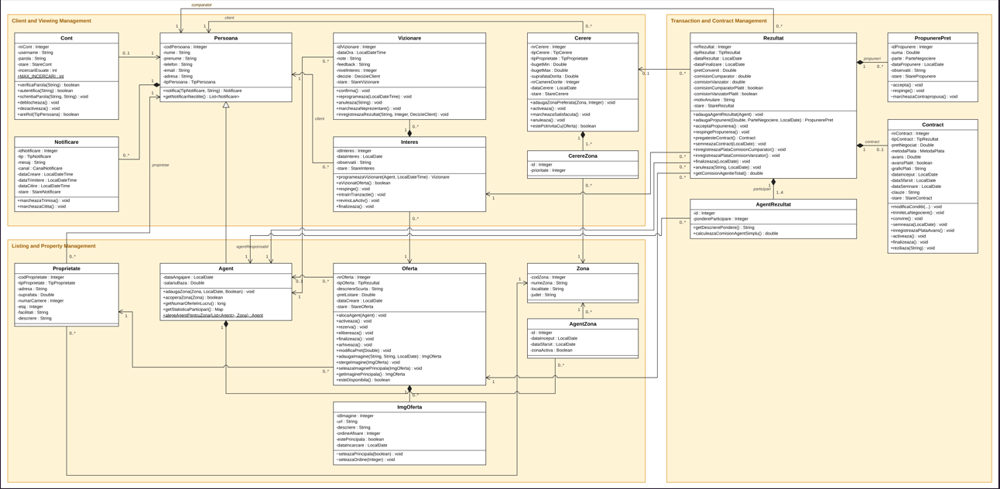
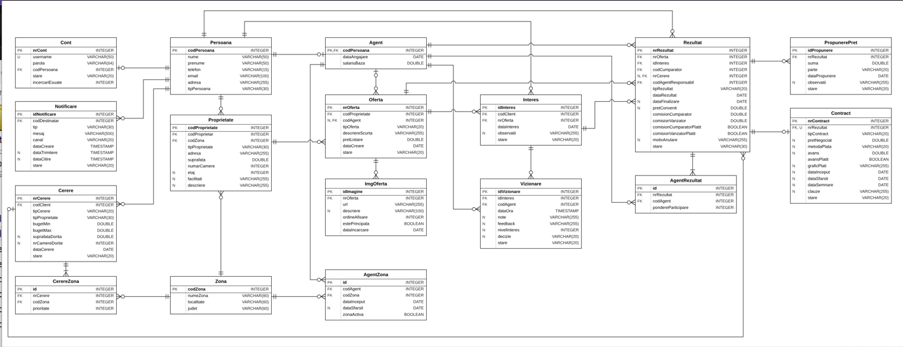

<div align="center">
  
# Real Estate Management System

</div>
The project is a web application for a real estate agency. It helps agency staff register properties, create listings, organize property viewings, manage clients, negotiate offers, prepare contracts, and track agency commissions. The application is used by the secretary, real estate agents, and the agency manager. Property owners and potential buyers or tenants communicate with the agency staff; they do not have accounts in the application.

The project has three main areas:
* Listing and Property Management - properties, listings, the zones of the agents and the assignment of listings to agents;
* Client and Viewing Management - clients, their requests, the interest in a listing and the viewings;
* Transaction and Contract Management - price negotiation, contracts, payments and commissions.

# Contents
* [Initial Backlog](#initial-backlog)
* [ADR 001 - Technology Stack Selection](#technology-stack-selection)
* [C4 Context Diagram](#c4-context-diagram)
* [Use Case Diagrams](#use-case-diagrams)
* [Class Diagram](#class-diagram)
* [Database Schema](#database-schema)
* [Our Team](#our-team)

# Initial Backlog
- **E1** - Property and Listing Management
- **E2** - Client and Viewing Management
- **E3** - Transaction and Contract Management

##### Table 1. Initial Product Backlog (User Stories)

| ID | Epic | User Story |
|----|------|------------|
| 1 | E1 | As a **secretary**, I want to register a property and its owner, so that the agency can promote it. |
| 2 | E1 | As a **secretary**, I want to create a listing for a property, so that it can be offered for sale or rent. |
| 3 | E1 | As a **secretary**, I want to assign a listing to an agent who covers its zone, so that every listing has a responsible agent. |
| 4 | E1 | As an **agent**, I want to activate and update my listings (price, description, photos), so that clients see correct offers. |
| 5 | E1 | As a **manager**, I want to define the zones covered by each agent, so that listings are assigned fairly. |
| 6 | E2 | As a **secretary**, I want to register a buyer or tenant with a request and preferred zones, so that suitable listings can be found. |
| 7 | E2 | As an **agent**, I want to schedule a viewing for an active listing, so that the client can see the property. |
| 8 | E2 | As an **agent**, I want to record the outcome and feedback of a viewing, so that I know if the client wants to continue. |
| 9 | E3 | As an **agent**, I want to record offers and counteroffers, so that the negotiation history is kept. |
| 10 | E3 | As an **agent**, I want to prepare and sign the contract, so that the agreement becomes official. |
| 11 | E3 | As an **agent**, I want to record payments and complete the transaction with commissions for both sides, so that the agency is paid. |
| 12 | E3 | As a **manager**, I want to see transaction and commission reports, so that I can follow the agency's results. |

## Acceptance Scenarios (Gherkin)

For each user story, we wrote a `.feature` file. The messages displayed by the application are kept in Romanian, exactly as the application shows them.
#### E1 - UC1_create_listing.feature

```gherkin
Feature: Create listing (Creare anunt)
  As a secretary or real estate agent
  I want to register a new listing for a client's property
  So that the property can be promoted by the agency

  Business rules:
  - The property belongs to a registered client (the owner).
  - A new listing must have a strictly positive asking price.
  - A new listing is created in state NOUA.

  Background:
    Given the user "andreea.calma" is logged in with role SECRETARA
    And the zone "Copou" from Iasi exists in the system

  Scenario: Successfully create a listing for an existing owner
    Given the client "Ciobanu Cristina" is registered in the system
    When the secretary registers an APARTAMENT property at "Bd. Carol I 40", zone "Copou", 78 sqm, 3 rooms
    And creates the VANZARE listing "Ap 3 camere Copou cu vedere" with the price 145000
    Then the listing is recorded in state NOUA
    And the listing has no agent assigned yet
    And the property is associated with the client "Ciobanu Cristina"

  Scenario: Create a listing for an owner who does not exist in the system
    Given the client "Moldovan Paul" is not registered in the system
    When the secretary searches for the owner "Moldovan Paul"
    Then the system displays a message that the owner does not exist
    When the secretary registers the client "Moldovan Paul" with the email "paul.moldovan@gmail.com"
    And creates the VANZARE listing "Spatiu comercial 80mp Baza 3" with the price 160000
    Then the listing is recorded in state NOUA for the owner "Moldovan Paul"

  Scenario Outline: Reject a listing with an invalid price
    Given the client "Dumitru Ion" is registered in the system
    When the secretary creates a listing with the price <price>
    Then the operation is rejected with the message "Pretul trebuie sa fie pozitiv!"
    And no new listing is recorded

    Examples:
      | price |
      | 0     |
      | -1000 |
```

#### E1 - UC2_assign_listing_to_agent.feature

```gherkin
Feature: Assign listing to agent (Alocare anunt la agent)
  As a secretary
  I want every new listing to be assigned to a real estate agent
  So that the listing is managed by the agent responsible for the property's zone

  Business rules:
  - A listing is assigned only to an agent who actively covers the property's zone.
  - If several agents cover the zone, the agent with the fewest listings in progress (ALOCATA, ACTIVA, REZERVATA) is chosen.
  - On assignment, the listing moves from NOUA to ALOCATA and the agent receives a notification.

  Background:
    Given the user "andreea.calma" is logged in with role SECRETARA
    And the listing "Ap 2 camere Canta, decomandat" from zone "Canta" is in state NOUA

  Scenario: Automatic assignment to the least loaded agent
    Given the agent "Popescu Alex" covers zone "Canta" and has 2 listings in progress
    And the agent "Matei Radu" covers zone "Canta" and has 0 listings in progress
    When the secretary assigns the listing
    Then the listing is assigned to the agent "Matei Radu"
    And the listing moves to state ALOCATA
    And the listing appears in the portfolio of the agent "Matei Radu"
    And the agent "Matei Radu" receives a notification of type ALOCARE_ANUNT

  Scenario: No agent covers the property's zone
    Given no agent actively covers zone "Canta"
    When the secretary assigns the listing
    Then the operation is rejected with the message "Niciun agent nu acopera zona Canta!"
    And the listing remains in state NOUA

  Scenario: Reassign an active listing to another agent
    Given the listing is in state ACTIVA and is assigned to the agent "Popescu Alex"
    And the agent "Matei Radu" covers zone "Canta"
    When the secretary reassigns the listing to the agent "Matei Radu"
    Then the listing disappears from the portfolio of the agent "Popescu Alex"
    And the listing appears in the portfolio of the agent "Matei Radu"
    And the listing remains in state ACTIVA

  Scenario Outline: Listings that can no longer be assigned
    Given the listing is in state <state>
    When the secretary assigns the listing to the agent "Matei Radu"
    Then the operation is rejected with the message "Oferta nu poate fi alocata in starea <state>"

    Examples:
      | state      |
      | REZERVATA  |
      | VANDUTA    |
      | INCHIRIATA |
      | ARHIVATA   |
```


# Technology stack selection
**Context:** The application needs a web interface, a backend for business rules and listing/viewing/transaction workflows, and persistent relational data (clients, listings, viewings, transactions, contracts and commissions).

**Options considered:**

- **Java + Spring Boot + PostgreSQL + React** - studied in the master's programme, good support for relational data;
- **.NET + ASP.NET Core + SQL Server + Angular** - a good framework, but the team has less experience with it;
- **Node.js + Express + MongoDB + React** - fast to start, but MongoDB is not a good fit for data with many relations.

**Proposed decision:** Java + Spring Boot + PostgreSQL + React.

**Why?** Spring Boot helps organize the backend and manage the application's main functions. PostgreSQL is used to store and manage data, while React helps create an interactive and user-friendly interface. This combination also fits well with the Java technologies studied during the master's programme.

**Consequences:** The application will be easier to organize, develop, and test because the frontend, backend, and database are separated. However, the team will need time to learn Spring Boot, connect the different parts of the application, and maintain them.

# C4 Context Diagram


# Use Case Diagrams

We made one use case diagram for each area. The actors are the persons who use the application - the **secretary**, the **real estate agent**, and the **agency manager** - and the **notification service**. Owners and buyers/tenants do not use the application, so they are not actors.

**Figure 2. Listing and Property Management use cases**


*Creare anunt* always includes *Inregistrare proprietate*, and *Inregistrare proprietar nou* extends it when the owner is not in the system. *Alocare anunt la agent* includes the selection of the agent by zone and workload.


# Class Diagram

The class diagram groups the classes into the three areas of the application. Client and Viewing Management contains Persoana, Cerere, CerereZona, Interes and Vizionare, together with Cont and Notificare. Listing and Property Management contains Proprietate, Oferta, ImgOferta, Agent, Zona and AgentZona. Transaction and Contract Management contains Rezultat, PropunerePret, Contract and AgentRezultat.

Agent inherits Persoana, because an agent is also a person, with extra data such as the hiring date and the base salary. The property (Proprietate) is separate from the listing (Oferta), so the same property can be listed again later. The client’s request (Cerere) shows what the client is looking for, the interest (Interes) links the client to one listing, and a viewing (Vizionare) is an appointment made for that interest. The transaction (Rezultat) keeps the price proposals, the contract and the agents who take part in it.

Each object that changes its state (Oferta, Cerere, Interes, Vizionare, Rezultat, PropunerePret, Contract) has a stare attribute. The state is changed only by the object’s own methods, such as activeaza(), rezerva() or finalizeaza(), and these methods check that the change is allowed. AgentZona, CerereZona and AgentRezultat are association classes. They link an agent to the zones they cover, a request to its preferred zones, and a transaction to its agents.



# Database Schema

The database was made starting from the class diagram. Each class became a table, and the associations between classes became foreign keys. Agent shares its primary key with Persoana, because an agent is also a person. The tables AgentZona, CerereZona and AgentRezultat are used for the many-to-many relationships: the zones of an agent, the preferred zones of a request, and the agents who take part in a transaction. The states and types are saved as text, with the same values as in the class diagram.



# Our Team


